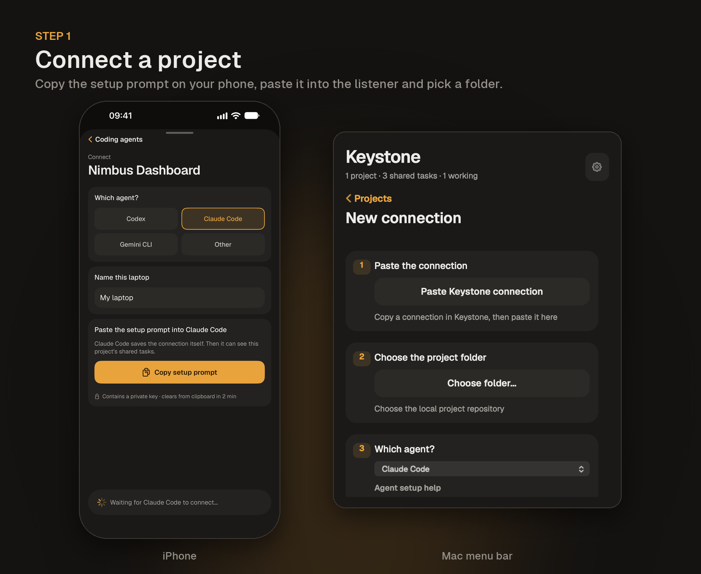
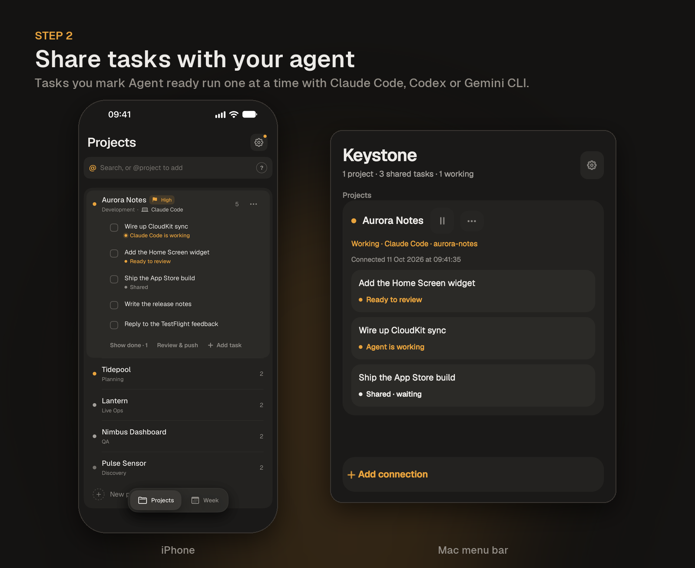
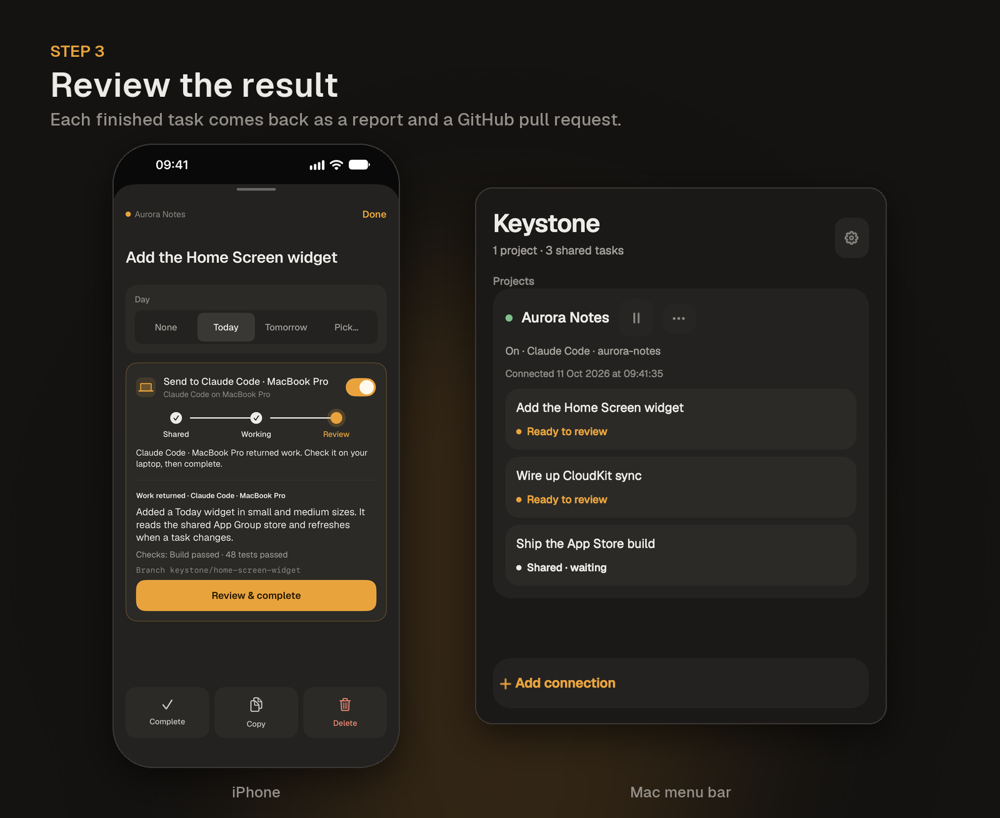

# Keystone Listener

A menu-bar app for macOS that connects the [Keystone](https://apps.apple.com/app/id6760302143) iPhone app to a coding agent on your Mac.

Mark a task **Agent ready** on your phone. The listener picks it up, runs your coding agent (Claude Code, Codex or Gemini CLI) in a separate working folder, and opens a GitHub pull request with the result. Merge the pull request and the task is completed on your phone. Close it and the task is no longer shared.

This repository only hosts the signed installer. It contains no source code.

## Download

**[Keystone-Listener-arm64.pkg](https://github.com/djock/keystone-listener/releases/latest/download/Keystone-Listener-arm64.pkg)** (Apple silicon, macOS 13 or later)

The installer is signed with a Developer ID and notarized by Apple. Each release lists its SHA-256 checksum.

## Requirements

- Keystone on your iPhone
- A Mac with Apple silicon, running macOS 13 or later
- A coding CLI, installed and signed in: `claude` (Claude Code), `codex` or `gemini`
- Git, with push access to the project's remote
- The GitHub CLI (`gh`), signed in with `gh auth login`, for pull requests

The app bundles its own runtime. You don't need Node or npm.

## Set up

1. Open the installer. It installs **Keystone Listener** in Applications.
2. Open the app. Its icon appears in the menu bar.
3. In Keystone on your iPhone, open Settings (the gear) and tap **Coding agents**. Coding agents are an invite-only beta: the first time, paste your invite link and tap **Connect**. Then choose the project, pick your agent and tap **Copy setup prompt**. The listener itself needs no invite.
4. In the menu-bar app, click **+ Add connection**, then **Paste Keystone connection**.
5. Choose the project's local folder and the agent, then click **Connect & enable**.

Turn on **Open at login** under Options if you want the listener to start with your Mac.

## How it works

- The listener checks for shared tasks every 15 seconds on power and every 60 seconds on battery. Checking uses ordinary HTTPS requests and no model calls. Running a task uses your agent's normal account or API usage.
- Each connection has one reusable working folder. Every task starts on a new branch from the latest upstream, so your own checkout, its files and its branch are never touched.
- The agent edits and checks the code. The listener commits, pushes (never with force) and opens the pull request. If the checks fail, the pull request is opened as a draft.
- To ask for changes, comment `/keystone <what to change>` on the pull request as its author. The listener runs the agent again on the same branch and replies with the new commit.
- Your Mac must be awake and the listener running. **Pause on battery** stops new work while on battery.

## Discord updates

Optionally, the listener posts a short card to a Discord channel each time a task changes: ready to review (with a link to the pull request), follow-up pushed, needs permission, failed, merged and closed.

1. In Discord, open the channel's **Edit Channel → Integrations → Webhooks**, choose **New Webhook** and **Copy Webhook URL**.
2. In the menu-bar app, open the gear menu → **Discord updates…**, paste the URL and choose **Save**. **Send test** posts a sample card; **Remove** turns updates off.

Mentions are disabled, a restart never posts the same update twice, and posting never delays a run. The webhook URL is stored privately on your Mac and shown masked. Task text, summaries, branch names and pull request links are visible to everyone in the channel.

## Privacy

Connection credentials, logs and run reports stay on your Mac in `~/.config/keystone-listener`, readable only by your user. The agent receives the task text, not your Keystone credential.

## Troubleshooting

- **A task stays "shared":** check that the project is enabled in the menu-bar app and that your Mac is awake.
- **"Needs authorization" or a failed run:** open the project's menu, choose **Logs**, and check your agent's permissions. You can retry from the same menu.
- **No pull request was opened:** make sure `gh auth status` succeeds and the folder has a GitHub remote.
- **"Already connected with …" when adding a connection:** a folder has one connection. To switch agents, open the project's ••• menu → **Edit connection** and pick the agent, then revoke the unused connection in Keystone on your iPhone.
- **After a crash:** the project's menu offers recovery once you have confirmed that the agent has stopped.

## Uninstall

Quit the app from its menu, then delete **Keystone Listener** from Applications. To remove its data as well, delete `~/.config/keystone-listener`.
